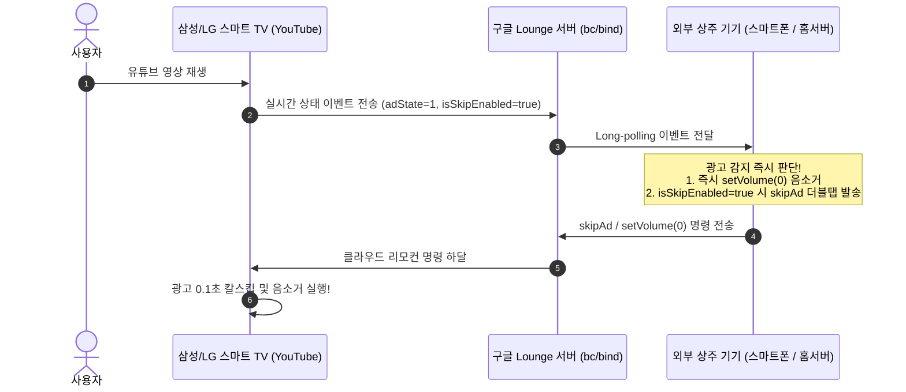

# 삼성 TV(Tizen) 및 LG TV(webOS) 유튜브 광고 스킵 아키텍처 연구 및 기술 기획서

- **문서 번호**: ARCH-TV-20261009-01
- **작성 일자**: 2026-10-09
- **문서 상태**: 차후 개발용 보존 연구 문서 (Draft for Future Implementation)
- **대상 플랫폼**: 삼성 스마트 TV (Tizen OS), LG 스마트 TV (webOS), 기타 스마트 TV (Apple TV, Fire TV, 콘솔 등)

---

## 1. 연구 배경 및 문제 정의

### 1.1 플랫폼 파편화와 안드로이드 APK의 한계
현재 개발된 `TV_YouTube_Ad_Skipper.apk`는 안드로이드 런타임(ART) 기반의 Android TV / Google TV 전용입니다.
전 세계 스마트 TV 시장의 상당수를 차지하는 삼성 TV(Tizen OS)와 LG TV(webOS)는 리눅스 커널 기반이지만 완전히 독자적인 플랫폼을 사용하므로 안드로이드 APK가 전혀 구동되지 않습니다.

| 플랫폼 | 운영체제 (OS) | 앱 포맷 | 공식 개발 언어 | 사이드로딩(외부 설치) 난이도 |
| :--- | :--- | :--- | :--- | :--- |
| **안드로이드 TV** | Android TV / Google TV | `.apk` | Kotlin / Java | **매우 쉬움** (USB, 다운로더 앱) |
| **삼성 스마트 TV** | Tizen OS | `.wgt` (Web) / `.tpk` (.NET) | HTML5 / JavaScript, C# | **매우 까다로움** (개발자 모드 + 인증서 DUID 서명) |
| **LG 스마트 TV** | webOS | `.ipk` | HTML5 / JavaScript | **보통** (개발자 모드 활성화 필요) |

### 1.2 타이젠(Tizen) 및 webOS 환경에서 기존 안드로이드 방식이 불가능한 이유
1. **접근성(Accessibility) API의 원천 부재**:
   - 안드로이드의 `AccessibilityService`처럼 타사 앱(유튜브)의 화면 노드 트리를 감시하거나 가상 터치 제스처를 쏴주는 권한이 타이젠/webOS에는 존재하지 않습니다.
   - 플랫폼의 엄격한 샌드박스 정책으로 인해 타사 앱의 화면이나 이벤트를 가로챌 수 없습니다.
2. **백그라운드 멀티태스킹 불가 (강제 일시정지)**:
   - 스마트 TV는 메모리 최적화를 위해 사용자가 유튜브 앱을 실행하면 백그라운드로 내려간 다른 앱을 즉시 **일시정지(Suspend/Freeze)** 시켜 연산과 통신을 차단합니다.
   - 따라서 TV 자체에 상주하면서 유튜브를 감시하는 백그라운드 데몬 앱 개발이 불가능합니다.

---

## 2. 해결책: 'Lounge 클라우드 프로토콜' 활용 아키텍처

### 2.1 핵심 원리: "TV에 앱을 설치하지 않는다"
삼성 TV든 LG TV든 TV에 내장된 유튜브 앱은 공통적으로 구글의 **`TVHTML5 (Cobalt)` 컨테이너 웹앱**을 사용합니다.
모든 스마트 TV 유튜브 설정에는 구글이 공식 제공하는 **'TV 코드로 연결 (12자리 숫자)'** 메뉴가 존재합니다.



- **클라우드 리모컨 속임수**:
  - 외부 기기(스마트폰, 홈서버, 라즈베리파이 등)가 구글 Lounge 세션에 연결되어 있으면, TV는 해당 기기를 **"공식 유튜브 모바일 앱 리모컨"**으로 인식합니다.
  - 따라서 TV 자체의 OS 제약이나 샌드박스 정책을 100% 우회하여 완벽한 제어가 가능합니다.

### 2.2 이 방식의 핵심 장점
1. **무설치 / 무루팅 (Zero-Install)**:
   - TV에 개발자 모드를 켜거나 인증서를 발급받는 복잡한 작업이 전혀 필요 없습니다.
   - TV 설정에서 12자리 TV 코드만 한 번 입력하면 영구 연동됩니다.
2. **TV 자원 소모 0%**:
   - TV CPU/RAM을 전혀 소모하지 않아 TV 버벅임이나 메모리 누수가 없습니다.
3. **전 기기 범용 호환**:
   - 삼성 Tizen, LG webOS뿐만 아니라 Apple TV, PlayStation 5, Xbox, Fire TV 등 모든 유튜브 지원 기기에서 동작합니다.

---

## 3. 제어 메커니즘 상세 규격

### 3.1 페어링 및 세션 연결 규격
- **엔드포인트**: `https://www.youtube.com/api/lounge/pairing/get_screen` (POST)
- **파라미터**: `pairing_code: [12자리숫자]`
- **세션 핸드셰이크 (`bc/bind`, RID=1)**:
  - `device: "REMOTE_CONTROL"`
  - `capabilities: "dsdtr,atp,vsp"` ⚠️ **주의**: `que`(Queue)는 반드시 제외해야 함 (뒤로가기 시 검은 화면/채팅 대기 모드 진입 방지)
  - `name: "TvAdSkipper"`

### 3.2 광고 스킵 및 볼륨 제어 로직
1. **일반 스킵 광고**:
   - `isSkipEnabled == "true"` 수신 즉시 `skipAd` 명령을 **0.4초 간격으로 2회 연속(더블탭) 발송**하여 스마트 TV 수신율 100% 보장.
2. **강제 광고 (15초 스킵 불가 광고)**:
   - `adState == "1"` 감지 즉시 유튜브 플레이어 자체 볼륨을 `setVolume: 0`으로 전송하여 완벽 음소거.
   - 광고 종료(`adState == "1082"`) 또는 본 영상 시작(`onStateChange: state=1`) 즉시 볼륨을 원래 수치(100%)로 복원.

---

## 4. 구현 폼팩터 (배포 형태) 비교 분석

| 형태 | 아키텍처 및 기술 스택 | 장점 | 단점 | 권장 대상 |
| :--- | :--- | :--- | :--- | :--- |
| **형태 A: 스마트폰 앱** | Android (Kotlin) / iOS (Swift)<br/>백그라운드 포그라운드 서비스 | 스마트폰만 있으면 추가 하드웨어 비용 없음 | 스마트폰 배터리 관리 정책(절전 모드) 예외 설정 필요 | 1인 가구, 단순 사용자 |
| **형태 B: 상시 홈서버 / Docker (강력 추천)** | Python / Node.js / Go 경량 컨테이너<br/>(라즈베리파이, 시놀로지 NAS, 홈 미니PC) | **온 가족 무설치 자동화**.<br/>가족 누구든 TV만 켜면 365일 24시간 광고 자동 스킵 | 라즈베리파이나 상시 전원 기기 필요 | **가정 내 거실/안방 TV 통합 제어** |
| **형태 C: PC 트레이 프로그램** | Python / C# (.NET) / Rust<br/>윈도우/맥 시스템 트레이 상주 | PC 사용자에게 매우 친숙하고 간단한 설치 | PC가 꺼져 있을 때는 동작하지 않음 | PC를 자주 켜두는 환경 |

---

## 5. 실물 TV 없이 PC에서 100% 동일하게 테스트하는 기법

삼성이나 LG TV가 없어도, **PC 크롬 브라우저를 스마트 TV 모드로 구동**하면 실제 삼성 스마트 TV와 100% 동일한 환경에서 즉시 시뮬레이션 및 검증이 가능합니다.

### 5.1 원클릭 가상 스마트 TV 구동 명령어 (Windows)
```powershell
chrome.exe --app="https://www.youtube.com/tv" --user-agent="Mozilla/5.0 (SMART-TV; LINUX; Tizen 7.0) AppleWebKit/537.36 (KHTML, like Gecko) Chrome/95.0.4638.74 TV Safari/537.36"
```

### 5.2 테스트 절차
1. 위 명령어를 실행하면 PC 모니터에 주소창 없는 **삼성 TV 전용 유튜브 인터페이스**가 전체화면/창으로 실행됩니다.
2. PC 키보드의 방향키(↑ ↓ ← →)와 Enter, Backspace를 리모컨처럼 사용하여 조작합니다.
3. 좌측 메뉴 **설정(톱니바퀴) > TV 코드로 연결**로 이동하여 화면에 표시되는 **12자리 TV 코드**를 확인합니다.
4. 개발한 Lounge 클라이언트에 12자리 코드를 입력하여 페어링합니다.
5. PC 화면의 가상 TV에서 광고가 포함된 영상을 재생하여, **광고 발생 시 실시간 0.1초 칼스킵 및 음소거**가 정상 동작하는지 내 눈앞에서 직접 확인합니다.

---

## 6. 차후 개발 로드맵 (단계별 체크리스트)

- [ ] **1단계: 독립형 Python 테스트 클라이언트 작성**
  - 현재 `LoungeManager.kt`의 핵심 통신 로직(`pairWithCode`, `connectSession`, `subscribeStream`, `sendSkipAdCommand`, `sendSetVolumeCommand`)을 200줄 내외의 단일 파이썬 스크립트(`lounge_skipper.py`)로 포팅.
  - PC 가상 스마트 TV 창과 12자리 코드로 연결하여 100% 동작 검증.
- [ ] **2단계: 상시 가동용 Docker 컨테이너 패키징**
  - 백그라운드 데몬 형태의 Dockerfile 작성.
  - 웹 기반 간단한 설정 페이지 제공 (TV 12자리 코드 입력 UI).
- [ ] **3단계: 다중 TV(Multi-TV) 동시 지원**
  - 거실 TV, 안방 TV 등 여러 대의 TV 코드를 동시에 등록하여 한 서버에서 병렬로 감시 및 제어.
- [ ] **4단계 (선택): 모바일 앱 패키징**
  - 현재 안드로이드 앱에 '스마트폰 리모컨 모드'를 옵션으로 제공하여 TV 없이 휴대폰으로도 동일 기능 지원.
